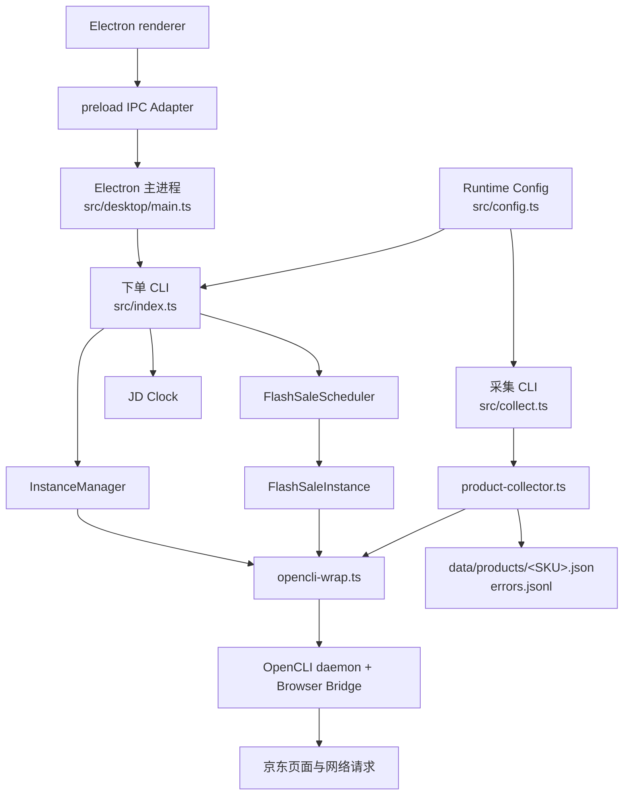

# JDauto 设计文档

## 设计概述

JDauto 是一个基于 TypeScript、Electron 和 OpenCLI Browser Bridge 的京东自动化项目。
当前包含两条相互独立、共享基础设施的业务链路：

1. 自动下单：面向定时抢购，执行预热、提交订单和支付。
2. SKU 商品信息采集：输入京东 SKU，捕获商品页聚合接口并输出原始 JSON。

两条链路共享账号配置、浏览器 profile 和 `opencli-wrap.ts`，但使用独立 CLI 入口，避免采集逻辑
进入支付状态机。

项目领域语言统一记录在 `CONTEXT.md`。其中 **Order Run**、**Product Capture**、
**Product Record**、**OpenCLI Profile** 和 **Runtime Config** 是架构讨论与代码文档使用的
标准术语。

### 目标

- 复用用户已登录的浏览器状态执行京东自动化。
- 保持下单状态机与商品采集任务职责分离。
- 商品采集结果与 `id采集商品信息.json` 的顶层结构一致。
- 提供批量输入、失败重试、断点续跑和可审计错误记录。

### 非目标

- 不绕过京东登录、安全验证或访问频控。
- 不保证浏览器采集链路可以稳定达到 10,000 SKU/日。
- 不把京东内部响应字段当作稳定的公开 API 契约。
- 不在配置文件中持久化支付密码。

## 整体架构



## 自动下单链路

入口为 `src/index.ts`：

1. 读取账号和任务配置，或使用命令行 SKU/时间覆盖任务。
2. `InstanceManager` 启动或复用配置中的浏览器 profile，并验证 Browser Bridge。
3. `syncJdClock` 估算京东服务器时间偏移。
4. `FlashSaleScheduler` 注册 `PREPARE` 和 `EXECUTE` 定时器。
5. 每个账号和任务对应一个 `FlashSaleInstance`，按状态机执行：
   `IDLE → PREPARE → EXECUTING → PAYMENT → DONE/FAILED`。
6. 页面打开、DOM 操作、加购和支付操作统一经过 `opencli-wrap.ts`。

## SKU 商品信息采集链路

入口为 `src/collect.ts`：

1. 从文件或标准输入读取 SKU。
2. `parseSkuInput` 支持纯文本、JSON 和 CSV；CSV 存在 `platform` 列时只保留 `jd`。
3. 按 profile 创建 worker。同一 profile 内串行，不同 profile 可并行。
4. 对每个 SKU 打开 `https://item.jd.com/<SKU>.html`。
5. OpenCLI 在导航前开始 Product Capture；采集器按时间检查
   `pc_detailpage_wareBusiness` 响应，只接受主商品 SKU 与输入 SKU 一致的响应。
6. 响应经过最小解包后构造以下顶层结构：

```json
{
  "商品ID": "10023749565113",
  "商品名称": "商品标题",
  "商品平台": "京东",
  "商品链接": "https://item.jd.com/10023749565113.html",
  "采集时间": "2026/7/26 13:21:28",
  "详情数据": {}
}
```

7. 结果先写临时文件再原子重命名为 `<SKU>.json`。
8. 已存在、可解析且详情 SKU 一致的 Product Record 默认跳过；旧的错配文件会重新采集。
   失败记录追加到 `errors.jsonl`。

## 核心 Module

| Module | Interface 与职责 |
| --- | --- |
| `src/index.ts` | 自动下单 CLI 参数解析和流程编排 |
| `src/collect.ts` | 商品采集 CLI 参数解析和进度输出 |
| `src/product-collector.ts` | SKU 输入、Product Capture 身份校验、Product Record 构造、worker、重试和落盘 |
| `src/config.ts` | Runtime Config 路径选择、字段验证、加载和原子保存 |
| `src/commands/opencli-wrap.ts` | OpenCLI 子进程、页面操作、网络捕获和支付封装 |
| `src/instance-manager.ts` | 浏览器实例启动、复用和 Bridge 就绪检查 |
| `src/instance.ts` | 单账号下单状态执行 |
| `src/scheduler.ts` | PREPARE/EXECUTE 定时调度 |
| `src/state-machine.ts` | 下单状态与合法状态转换 |
| `src/jd-clock.ts` | 京东服务器时间偏移估算 |
| `src/desktop/main.ts` | Electron 窗口、下单进程与日志管理 |
| `src/desktop/ipc-contract.cts` | 桌面 renderer 与主进程之间的 IPC Interface |
| `src/desktop/preload.cts` | 沙箱 renderer 的 IPC Adapter |
| `scripts/clean-dist.mjs` | 构建前安全清理 `dist`，避免旧编译产物进入安装包 |

## 关键设计决策

| 日期 | 决策 | 理由 |
| --- | --- | --- |
| 2026-07-26 | 采集使用独立 `jdcollect` 入口 | 防止批处理逻辑污染下单和支付状态机 |
| 2026-07-26 | 捕获聚合接口而非拼装 DOM | 保留详情字段并与目标 JSON 接近 |
| 2026-07-26 | 单 profile 串行、多 profile worker | 避免同一浏览器上下文命令竞争 |
| 2026-07-26 | 每 SKU 一个 JSON 文件 | 支持原子写入、断点续跑和局部重试 |
| 2026-07-26 | 固定 OpenCLI 1.7.14 | 当前封装依赖该版本的 browser 命令格式 |
| 2026-07-27 | 保持 OpenCLI 1.7.14，同时提升兼容的传递依赖 | 修复依赖审计中的高危漏洞，不改变 OpenCLI Interface |
| 2026-07-27 | Product Capture 必须校验目标 SKU | 选择 fail-closed，避免 30 秒捕获窗口中的旧响应造成静默数据污染 |
| 2026-07-27 | Runtime Config 集中验证并原子保存 | 将格式不变量和错误定位集中到一个深 Module |
| 2026-07-27 | Electron renderer 只通过 preload IPC Seam 调用主进程 | 关闭 renderer Node.js 集成并启用上下文隔离与 sandbox |
| 2026-07-27 | 测试使用 `.mjs` 且执行前自动构建 | 遵循依赖要求的 Node `>=22.19` 契约，并避免测试被忽略目录中的陈旧 `dist` |
| 2026-07-27 | 每次 TypeScript 构建前安全清理 `dist` | 防止重命名或删除源码后，旧产物继续进入桌面安装包 |

## 已知限制

- 2026-07-26 的 30 SKU 端到端验证中仅成功 14 条，随后进入京东 `reason=403`
  PC 频控页；详见 `docs/e2e-validation-2026-07-26.md`。
- 多 profile 可以提升本地并行度，但共享公网出口时不能视为频控解决方案。
- `pc_detailpage_wareBusiness` 是页面内部接口，名称和响应字段可能变化。
- Browser Bridge、profile 登录态和京东页面状态均是运行前置条件。
- 当前桌面端只编排自动下单；商品采集通过 CLI 使用。

## 安全与运维

- 支付密码只从命令行或 `JDAUTO_PASSWORD` 注入，不写入配置。
- SKU 输入必须是 5–20 位数字或标准京东商品链接。
- Product Record 的顶层商品 ID 和详情主 SKU 必须同时匹配输入 SKU。
- 采集失败不会生成半写入 JSON；中间文件仅用于原子落盘。
- 采集输出位于 `data/`，不进入版本控制。
- Electron renderer 不直接访问 Node.js 或 Electron，只使用 preload 暴露的有限 IPC Interface。
- 遇到 403、验证页或登录失效时应停止任务并检查平台规则，不应简单扩容规避限制。

## 验证

```powershell
npm run build
npm test
```

`npm test` 会先构建，再运行 JavaScript 测试。测试覆盖原状态机冒烟检查、Runtime Config
验证与保存、SKU 文本/JSON/CSV 解析、Product Capture 身份校验、断点续跑、输出结构和
样例数据回归。

## 变更历史

### 2026-07-27 - 第一阶段仓库重构

**变更内容**: 深化 Product Capture 与 Runtime Config Module，让 Electron preload 成为真实
IPC Seam，并让测试在干净检出中自包含。

**变更理由**: 消除批量采集的静默 SKU 错配风险，集中配置不变量，减少 renderer 权限，同时
清理不承载决策的空白协作模板。

**影响范围**: SKU 采集正确性、配置加载/保存、Electron IPC、测试入口与项目文档。CLI 参数和
Product Record JSON 结构保持不变。

**决策依据**: 优先实施可单元测试、向后兼容且不会改写 Order Run 时序的重构；OpenCLI 全量拆分
与下单状态机深化保留为后续独立阶段。
